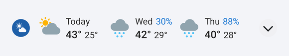
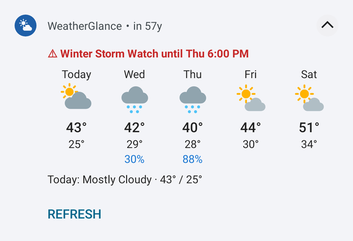
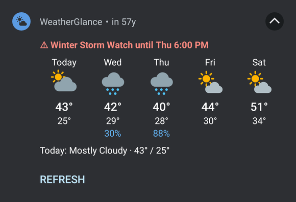
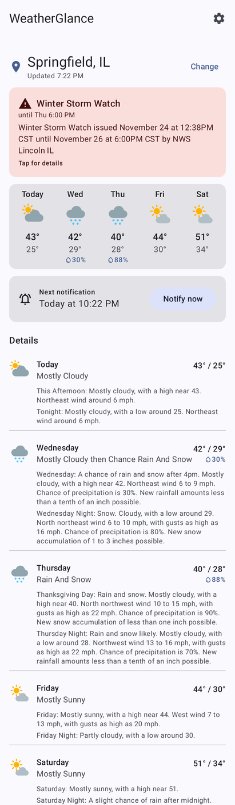
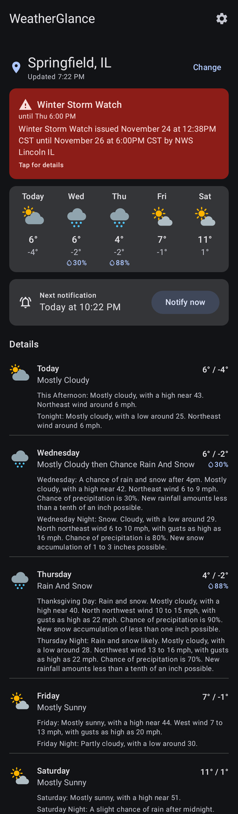

# WeatherGlance

An Android app that posts your forecast as a notification at the times you choose: three days at a
glance, five when you expand it. Forecast data comes from the US National Weather Service.

| Collapsed | Expanded (light / dark) |
| --- | --- |
|  |   |

| App (light) | App (dark, °C) |
| --- | --- |
|  |  |

> These images are produced by the Robolectric render tests (`app/build/notification-renders/`).

## Features

- **Scheduled forecast notification.** Choose up to six times of day and which days of the week. The
  collapsed view shows 3 days and the expanded view shows 5, each with a condition icon, high/low and
  precipitation chance. A **Refresh** action updates it in place.
- **Severe weather alerts.** NWS watches and warnings at or above a chosen severity arrive as their
  own high-priority notifications. Each alert is announced once and dismisses itself when it expires.
  Alerts are checked about once an hour between forecasts, and the top alert also appears in the
  expanded forecast.
- **Offline fallback.** A failed fetch is retried with backoff (about 30s, 60s, then 120s). After
  that, the last forecast is shown if it is under 24 hours old, marked "Saved forecast".
- **Home-screen widget** (Glance). Shows 3 days when narrow and 5 when wide.
- **°F / °C**, converted on display, so switching units needs no refetch.
- **City or ZIP search** using the platform `Geocoder`. Results are limited to NWS coverage (the US and
  its territories), and the location is checked against NWS before it is saved.

## Architecture

```
ui/            Compose screens (home, settings, location search), shared formatter
notification/  RemoteViews notification factory, publish use case, alert notifier, channels
scheduling/    WorkManager scheduler + workers, pure ScheduleCalculator, time-change receiver
widget/        Glance widget
data/nws/      Retrofit API, DTOs, period→day mapper, icon/condition parser
data/forecast/ Repository + DataStore cache
data/settings/ Typed JSON DataStore for user settings
domain/        Models shared by every layer
```

Hilt wires everything together. Persistence uses two typed DataStores backed by kotlinx.serialization:
user settings, which are backed up to the cloud, and the forecast cache, which is not.

### How scheduling works

Each upcoming slot is a single `OneTimeWorkRequest`, enqueued as unique work named after its target
instant (`forecast-slot-<epoch>`) with the `KEEP` policy. Because of that:

- **Scheduling is idempotent.** The worker schedules the *next* slot before doing anything else, on
  every attempt including retries. App launch and system time-change broadcasts can also ask for "the
  next slot" without ever creating duplicates.
- **Wall-clock times survive DST and travel.** `ScheduleCalculator` works in local time: a 02:30 slot on a
  spring-forward day moves to 03:30, and an overlap fires only once. `TIMEZONE_CHANGED` and `TIME_SET` trigger a
  reschedule.
- **Stale slots are skipped.** If the device was off at 07:00 and boots at noon, the morning
  notification is dropped instead of arriving five hours late.
- **Slots are not network-constrained, on purpose.** A network constraint would hold the job while
  offline, which would defeat the cached-forecast fallback.

Timing is approximate. Doze can defer work by a few minutes, which avoids the exact-alarm permission.

### NWS details worth knowing

- `/points/{lat},{lon}` resolves the forecast grid and the location's time zone. If the forecast
  returns 404 because NWS re-gridded an office, the point is resolved again once.
- Forecast periods alternate between day and night. They are grouped by the local date of
  `startTime`, which carries the location's offset. The daytime period supplies the high, icon and
  precipitation; that evening's period supplies the low. An evening fetch produces a "Tonight" entry.
- The condition comes from the icon URL codes (for example `.../day/bkn/snow,30`). When a period
  has two codes, the more significant one wins, so "Mostly cloudy then snow" shows snow.
- Alerts with a status other than `Actual` (Test or Exercise) are ignored.

## Building

Requirements: JDK 17+ and the Android SDK (API 35).

```bash
./gradlew assembleDebug
```

```bash
./gradlew detekt lintDebug testDebugUnitTest
```

NWS asks clients to identify themselves in the `User-Agent` header. The default is
`WeatherGlance/<version> (Android)`. To include your own contact for a distributed build, set it like this:

```bash
./gradlew assembleRelease -PnwsUserAgent="WeatherGlance/1.0 (you@example.com)"
```

### Tests

- **Unit tests** cover the NWS mapper (against recorded real responses in
  `app/src/test/resources/nws`), the condition parser, schedule computation including DST edge cases,
  unit conversion and settings serialization.
- **API test.** `NwsApiTest` runs the real OkHttp/Retrofit stack against MockWebServer. It checks the
  User-Agent header and that the point is not double-encoded.
- **Render tests** (Robolectric, native graphics) inflate the real notification, including the system
  decoration, plus the home screen, and write PNGs to `app/build/notification-renders/`. They catch
  RemoteViews problems that would otherwise only show up as "Bad notification posted" crashes on a
  device.

`tools/generate_weather_icons.py` regenerates the weather vector drawables from shared geometry.

## CI

`.github/workflows/ci.yml` runs detekt, Android Lint, the unit and render tests, and debug and
minified release builds. It uploads reports, renders and the debug APK. Dependabot keeps Gradle
dependencies and Actions current.
